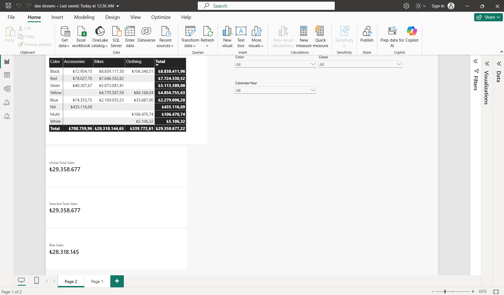

# 📊 AdventureWorks Power BI & Advanced DAX Analytics

This repository contains an end-to-end Power BI data analytics solution based on the **AdventureWorks** Star Schema dataset. The project focuses on data modeling, advanced DAX calculations, filter context manipulation, and report design best practices.

---

## 📸 Dashboard Preview



---

## 🎯 Project Objectives & Key Learnings

- **Data Modeling:** Built a clean Star Schema utilizing `FactInternetSales`, `DimDate`, `DimProduct`, and `DimProductCategory`.
- **DAX Mechanics & Optimization:**
  - Mastered Filter Context, Row Context, and Context Transition mechanics.
  - Applied `CALCULATE`, `ALL`, `ALLSELECTED`, and `ALLEXCEPT` functions for dynamic context adjustment.
  - Followed Best Practices: Avoided unnecessary iterator functions (`SUMX`), preferred direct column filters, and implemented safe division with `DIVIDE`.

---

## 🧠 DAX Formulas Implemented

### 1. Base Measures
Total Sales = SUM(FactInternetSales[SalesAmount])

### 2. Context Manipulation (ALL vs ALLSELECTED)
-- Ignores product and date filters (Global Total)
Global Total Sales = CALCULATE([Total Sales], ALL(DimProduct), ALL(DimDate))

-- Respects slicer choices but ignores visual row context
Selected Total Sales = CALCULATE([Total Sales], ALLSELECTED(DimProduct), ALLSELECTED(DimDate))

-- Filtered Category Measure
Bike Sales = CALCULATE([Total Sales], DimProductCategory[EnglishProductCategoryName] = "Bikes")

### 3. Central Tendency Analysis
Average Sales = AVERAGE(FactInternetSales[SalesAmount])

---

## 🚀 Roadmap (Course Progress)
- [x] Basic & Advanced Context Filtering (CALCULATE, ALL, ALLSELECTED)
- [x] Central Tendency & Customer Level Analysis
- [x] Advanced Filtering (ALLEXCEPT & FILTER thresholds)
- [x] Time Intelligence Analysis (YTD, Prior Year)

### 4. Time Intelligence & Financial Metrics
- **Sales MTD (Month-to-Date):**
  ```dax
  Sales MTD = CALCULATE([Toplam], DATESMTD(DimDate[FullDateAlternateKey]))
  Sales YTD = CALCULATE([Toplam], DATESYTD(DimDate[FullDateAlternateKey]))
  SAMEPERIOD = CALCULATE([Toplam], SAMEPERIODLASTYEAR(DimDate[FullDateAlternateKey]))
  YoY Sales Growth % = DIVIDE([Toplam] - [SAMEPERIOD], [SAMEPERIOD], 0)
